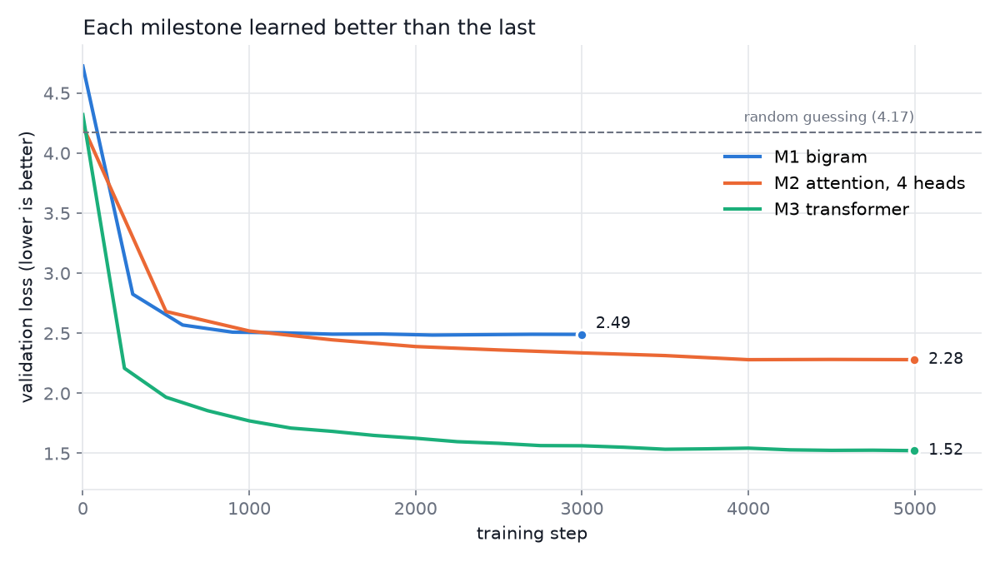
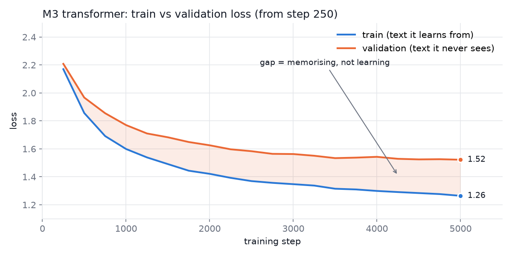
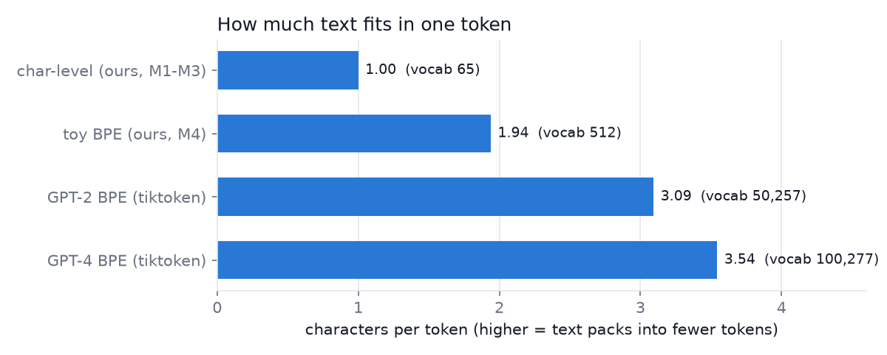

# Tiny GPT

A character-level GPT built from scratch in PyTorch, step by step, and trained on Shakespeare on a laptop GPU (RTX 3050, 4 GB). Plus a toy byte-pair-encoding (BPE) tokenizer compared against the real GPT-2 and GPT-4 tokenizers.

The goal was to understand every line of the model, not to build the best one. Each milestone adds one idea, and the loss shows what that idea is worth.



| Model | File | Parameters | Val loss |
|---|---|---|---|
| Random guessing | – | – | 4.17 |
| M1 bigram | `bigram.py` | 4,225 | 2.49 |
| M2 attention, 4 heads | `gpt.py` @ M2 commit | 7,553 | 2.28 |
| **M3 transformer** | `gpt.py` | 1,827,137 | **1.52** (5.3 min to train) |

**Sample from the M3 transformer:**

```
And thee, Warwick thou wilt from banishly father's:
No marriaged men seize their open in mocks.
Look, will thee doth me other mine eyes,
...
OXTANLE:
You shall rise: the good king, sir,
```

It has learned spelling, verse rhythm and the layout of a play. It hasn't learned meaning: 1.8M parameters reading one character at a time isn't enough for that.

## How it works

### The task

A language model does one thing: given some text, predict the next character. To write, it predicts one character, appends it, and repeats. Training data labels itself: for any chunk of text, the answers are the same text shifted one place to the right.

### M1 – Bigram model (`bigram.py`)

The data pipeline and training loop that every later model reuses.

| Part | What it does |
|---|---|
| `encode` / `decode` | Character tokenizer: each of the 65 distinct characters gets an ID 0–64. |
| `get_batch` | Picks 32 random 8-character chunks `x`, with targets `y` = `x` shifted by one. |
| `nn.Embedding(65, 65)` | The whole model: a 65 × 65 table where row *t* holds scores for what follows character *t*. |
| `F.cross_entropy` | The loss: how surprised the model was by the right answer. 4.17 = uniform guessing over 65 characters. |
| `loss.backward()` + `optimizer.step()` | Work out how each weight contributed to the error, then nudge it to do better. |
| `estimate_loss` | Averages loss over 200 batches on both train and held-out validation text (last 10%). |
| `generate` | Sample a character from the predicted probabilities, append, repeat. |

**Limit:** it only sees one character, so after `e` it predicts the same thing whether the word was `the` or `love`.

### M2 – Self-attention (`attention_demo.py`, `gpt.py` at the M2 commit)

Lets each character look back at all earlier characters and decide which ones matter.

- `attention_demo.py` builds the idea up in four steps: averaging the past in a loop → the same thing as one matrix multiply with a lower-triangular matrix → softmax with future positions masked to `-inf` → weights computed from the data with **query**, **key** and **value** projections.
- Each character emits a *query* ("what am I looking for?") and a *key* ("what do I contain?"). Their dot product scores how relevant each earlier character is. Softmax turns scores into weights, which mix the *values*.
- Scores are divided by √head_size so softmax doesn't saturate (the demo checks this: variance ~20 unscaled → ~1 scaled).
- **Position embeddings** are added because attention alone ignores order.
- **Multi-head:** 4 heads of size 8 beat 1 head of size 32 (2.28 vs 2.41) with the same parameter count, because each head can track a different pattern.

### M3 – Full transformer (`gpt.py`)

```
x ─┬─> LayerNorm ─> Multi-head attention ─┐
   └──────────────── + <──────────────────┘    communicate
x ─┬─> LayerNorm ─> Feed-forward ─────────┐
   └──────────────── + <──────────────────┘    compute
                × 4 blocks
```

| Part | Why |
|---|---|
| `FeedForward` | Attention moves information between characters; this 2-layer network lets each character process what it gathered. |
| Residual `x = x + f(x)` | Each layer adds a correction instead of replacing `x`. Gradients flow straight through the `+`, so deep stacks train. |
| `LayerNorm` (pre-norm) | Keeps activations in a stable range through many layers. |
| `proj` after the heads | Mixes the concatenated head outputs back together. |
| `Dropout(0.1)` | Randomly zeroes values during training to reduce memorising. |
| Scale-up | Context 8 → 128 characters, width 32 → 192, 4 stacked blocks. |



The growing gap between train (1.26) and validation (1.52) loss is **overfitting**: the model starts memorising its training text. Validation improvement slowed sharply after step 3500, so longer training at this size wouldn't help much. More data or more regularisation would.

### M4 – Toy BPE tokenizer (`bpe.py`)

Byte-pair encoding: start from raw UTF-8 bytes (256 symbols), repeatedly find the most frequent adjacent pair and merge it into a new symbol. 256 merges gives a 512-token vocabulary. Working on bytes means it can encode *any* text: emoji and Hindi round-trip exactly, which the 65-character tokenizer can't do at all.



How each tokenizer splits the same sentence (`|` = token boundary, `␣` = space):

```
char-level (42)  T|o|␣|b|e|,|␣|o|r|␣|n|o|t|␣|t|o|␣|b|e|,|␣|t|h|a|t|...
toy BPE    (17)  To␣|b|e,␣|or|␣|not␣|to␣|b|e,␣|that␣|is␣|the␣|qu|es|t|ion|:
GPT-2      (13)  To|␣be|,|␣or|␣not|␣to|␣be|,|␣that|␣is|␣the|␣question|:
```

**Lesson:** the toy BPE glues punctuation onto letters (`e,␣`) because it merges across word boundaries. Real tokenizers first split text with a regex into words, numbers and punctuation, and only merge inside each piece, which gives clean tokens like `␣be` and `,`.

## Run it

```powershell
python -m venv .venv
.venv\Scripts\pip install -r requirements.txt

.venv\Scripts\python bigram.py           # M1
.venv\Scripts\python attention_demo.py   # M2 maths walkthrough
.venv\Scripts\python gpt.py              # M3, ~5 min on an RTX 3050
.venv\Scripts\python bpe.py              # M4, ~1 min
.venv\Scripts\python plot_losses.py      # redraws the charts in docs/
```

Training text: [Tiny Shakespeare](https://github.com/karpathy/char-rnn/tree/master/data/tinyshakespeare) (1.1M characters), in `data/input.txt`.

## Files

| Path | Contents |
|---|---|
| `bigram.py` | M1: data pipeline, training loop, bigram model |
| `attention_demo.py` | M2: attention maths on toy tensors |
| `gpt.py` | M3: full transformer; saves history, sample and weights to `runs/` |
| `bpe.py` | M4: BPE tokenizer and comparison with tiktoken |
| `plot_losses.py` | M5: draws the charts in `docs/` |
| `runs/` | Loss histories, M3 text sample, learned BPE merges (`gpt.pt` weights are gitignored) |
| `docs/` | Charts, plus `explained.html`, an interactive beginner's walkthrough of M1–M2 |

## Credits

The model structure follows Andrej Karpathy's [“Let's build GPT”](https://www.youtube.com/watch?v=kCc8FmEb1nY) and [minbpe](https://github.com/karpathy/minbpe), rebuilt line by line for learning.
