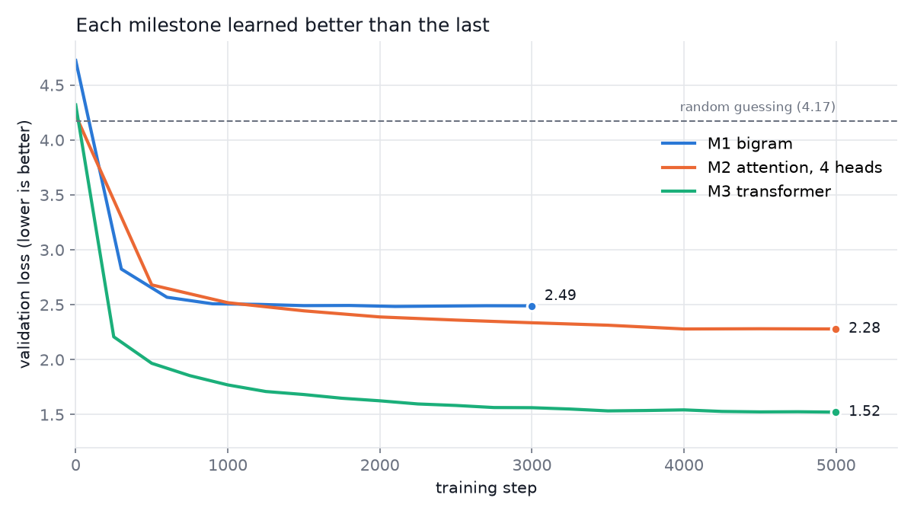

# Applied AI projects

Hands-on projects with language models: one built from scratch to understand the internals, and one full-stack app that puts a production model to work.

| Project | What it is | Stack |
|---|---|---|
| [Tiny GPT](Mini-gpt/) | A character-level GPT built step by step and trained on a laptop GPU | Python, PyTorch |
| [Notebook RAG](notebook-rag/notebook-rag/) · [live demo](https://notebook-rag-lovat.vercel.app) | A NotebookLM-style assistant that answers only from your sources, with citations | Next.js, TypeScript, OpenAI, Qdrant |

---

## Tiny GPT

A character-level GPT written in PyTorch and trained on Shakespeare on an RTX 3050 (4 GB). Each milestone adds one idea, and the validation loss shows what that idea is worth.

| Model | Parameters | Val loss |
|---|---|---|
| Random guessing | – | 4.17 |
| Bigram | 4,225 | 2.49 |
| Attention, 4 heads | 7,553 | 2.28 |
| **Transformer** | 1,827,137 | **1.52** |

It also includes a toy byte-pair-encoding (BPE) tokenizer compared against the real GPT-2 and GPT-4 tokenizers.

→ [Full write-up and how to run it](Mini-gpt/README.md)

## Notebook RAG

Create notebooks, add sources, and ask questions that are answered **only** from those sources.

- **Five source types:** PDF, website URL, YouTube, VTT/SRT transcripts and pasted text
- **Clickable citations** that open the exact page, passage or video timestamp
- **Notebook isolation:** vector search is filtered by notebook, so one notebook never retrieves another's data
- **Grounding guardrail:** if nothing relevant is retrieved, the app says so instead of guessing

Built with Next.js (App Router), OpenAI (`text-embedding-3-small`, `gpt-4o-mini`) and Qdrant Cloud, deployed on Vercel.

→ [Architecture, setup and environment variables](notebook-rag/notebook-rag/README.md)
